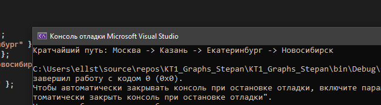

КТ1 Графы (Задание «Написать код или привести пример кода»)

Программа демонстрирует применение графов в программировании на примере карты авиарейсов.
Каждый город — это вершина графа, а рейс между ними - ребро.
Программа находит кратчайший путь (по количеству пересадок) из заданного начального города в конечный.

Реализация:
1. Хранение графа: Используется список смежности (Dictionary<string, List<string>>), что экономит память по сравнению с матрицей смежности. Для каждой вершины (Adj(u)) хранится список смежных городов.

2. Алгоритм поиска: Используется обход в ширину (BFS — Breadth-First Search). Этот алгоритм идеально подходит для поиска кратчайшего пути в невзвешенном графе, так как он исследует граф "волнами" (сначала прямых соседей, затем соседей соседей и т.д.).

3. Восстановление маршрута: В процессе поиска программа запоминает "родителей" для каждого города (откуда мы в него прилетели). Дойдя до цели, она "разворачивает" цепочку и выводит готовый маршрут.

